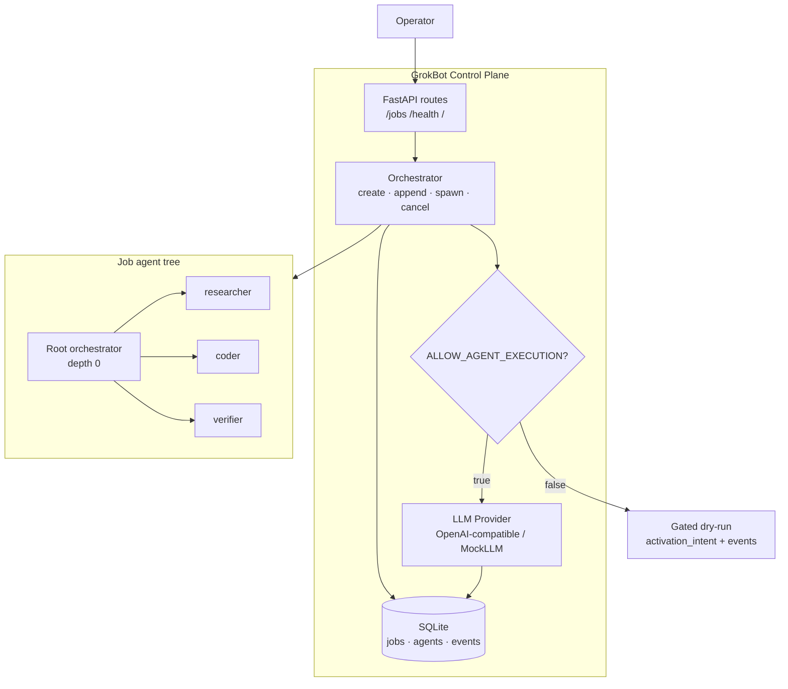

# GrokBot Orchestrator

FastAPI + SQLite AI orchestration control plane. Operators create hard-task jobs, append mid-flight, and spawn sub-agents under a gated multi-agent execution model.

## Architecture



When `ALLOW_AGENT_EXECUTION=false` (default), activations still create agent records and events but return a **dry-run activation intent** (`status=gated`). When `true`, the pluggable LLM provider runs.

## Layout

```
grokbot-orchestrator/
  app/           # FastAPI app, orchestrator, LLM, routes
  templates/     # HTML dashboard
  tests/         # pytest suite
  data/          # SQLite files
```

## Quickstart

```bash
cd orchestrator
python3.11 -m venv .venv
source .venv/bin/activate
pip install -r requirements.txt

# optional: copy env
cp .env.example .env

# tests
pytest -q

# run server
uvicorn app.main:app --host 0.0.0.0 --port 8000 --reload
```

Open http://localhost:8000/ for the dashboard, http://localhost:8000/docs for OpenAPI.

### Docker

```bash
docker build -t grokbot-orchestrator .
docker run -p 8000:8000 -e ALLOW_AGENT_EXECUTION=false grokbot-orchestrator
```

## Configuration

| Env | Default | Meaning |
|-----|---------|---------|
| `DATABASE_URL` | `sqlite:///./data/grokbot.db` | SQLite path |
| `MAX_AGENT_DEPTH` | `3` | Max spawn depth (root=0) |
| `ALLOW_AGENT_EXECUTION` | `false` | Gate vs call LLM |
| `LLM_BASE_URL` | `http://localhost:11434/v1` | OpenAI-compatible API |
| `LLM_API_KEY` | `sk-stub` | API key |
| `LLM_MODEL` | `gpt-4o-mini` | Model id |
| `SOURCE_DEFAULT` | `grokbot-orchestrator` | Default job source |

## Key endpoints

| Method | Path | Description |
|--------|------|-------------|
| `GET` | `/` | HTML dashboard |
| `GET` | `/health` | Health + config flags |
| `POST` | `/jobs` | Create job + root orchestrator |
| `GET` | `/jobs/{id}` | Status + agent tree |
| `GET` | `/jobs/{id}/agents` | Flat agent list |
| `GET` | `/jobs/{id}/events` | Paginated events |
| `POST` | `/jobs/{id}/append` | Mid-flight operator text |
| `POST` | `/jobs/{id}/spawn` | Spawn sub-agent |
| `POST` | `/jobs/{id}/cancel` | Cancel job + agents |

## Curl examples

### Create job

```bash
curl -s -X POST http://localhost:8000/jobs \
  -H 'Content-Type: application/json' \
  -d '{"goal":"Design a multi-agent research pipeline","priority":2}'
```

### Append mid-flight

```bash
JOB_ID=job_...   # from create response
curl -s -X POST "http://localhost:8000/jobs/$JOB_ID/append" \
  -H 'Content-Type: application/json' \
  -d '{"text":"Prefer open-source tools only"}'
```

### Spawn sub-agent

```bash
curl -s -X POST "http://localhost:8000/jobs/$JOB_ID/spawn" \
  -H 'Content-Type: application/json' \
  -d '{"role":"researcher","goal":"Survey orchestration patterns"}'
```

Roles: `researcher`, `coder`, `verifier` (and `orchestrator`). Optional `parent_agent_id` nests under a specific agent.

### Status / events / cancel

```bash
curl -s "http://localhost:8000/jobs/$JOB_ID"
curl -s "http://localhost:8000/jobs/$JOB_ID/events?limit=20"
curl -s -X POST "http://localhost:8000/jobs/$JOB_ID/cancel"
```

## Model

- **Job** → root **orchestrator** agent → spawnable **researcher / coder / verifier**
- Depth limited by `MAX_AGENT_DEPTH` (default 3)
- `MockLLMProvider` used in tests; production can point at any OpenAI-compatible endpoint

## License

Internal / demo use.
