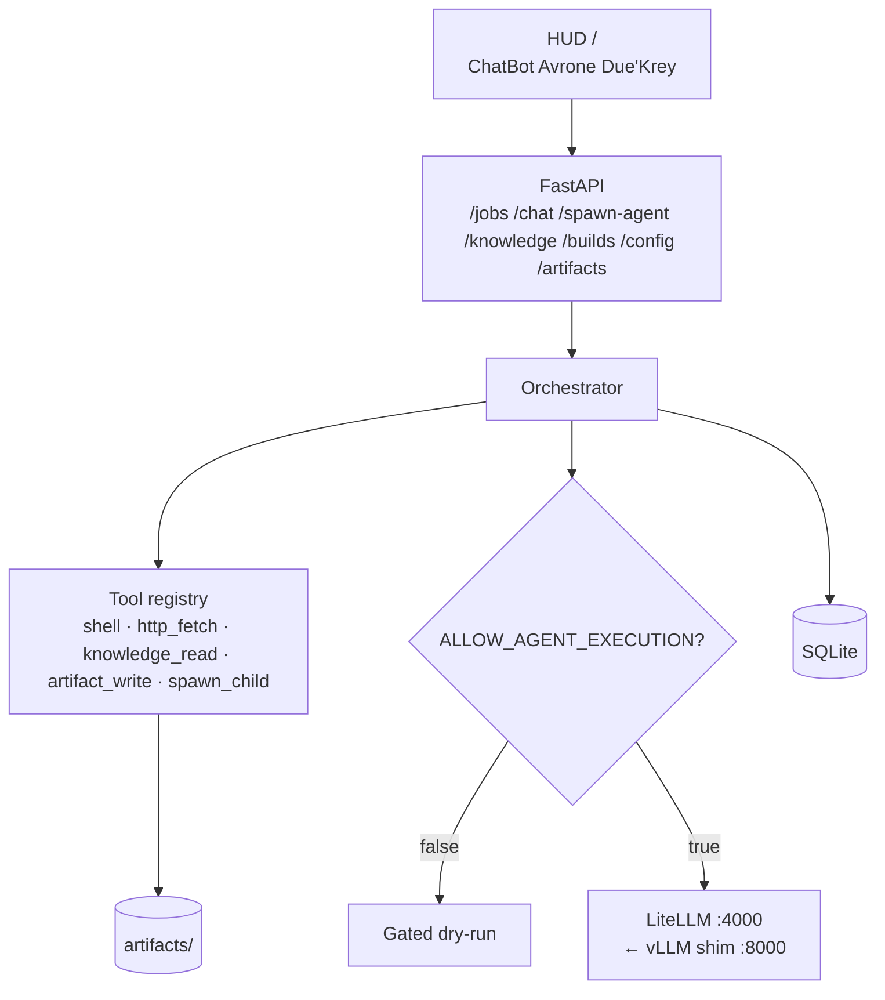

# ChatBot Avrone Due'Krey — Orchestrator

FastAPI + SQLite control plane for **Sub-Agent Orchestration** and **Spawn-Agent for Tasks**. Part of the `avrone-host` / `avrone-duekrey-daemon` platform.

Default listen port in the full stack: **9100** (standalone quickstart may still use uvicorn defaults).

## Architecture



## Quickstart (orchestrator only)

```bash
cd orchestrator
python3 -m venv .venv && source .venv/bin/activate
pip install -r requirements.txt
cp .env.example .env
pytest -q
uvicorn app.main:app --host 0.0.0.0 --port 9100
```

Prefer the platform daemon for the full stack — see `../platform/README.md`.

## Ports (full platform)

| Port | Role |
|------|------|
| 8000 | vLLM OpenAI shim |
| 4000 | LiteLLM |
| 9100 | Orchestrator + HUD |
| 9101 | Compat shim |
| 9102 | Artifacts |

## Key endpoints

| Method | Path | Description |
|--------|------|-------------|
| `GET` | `/` | ChatBot Avrone Due'Krey HUD |
| `GET` | `/health` | Health + ports |
| `GET` | `/services` | Service status tiles |
| `POST` | `/chat` | Chat completion |
| `POST` | `/chat/stream` | SSE chat stream |
| `POST` | `/spawn-agent` | Spawn-Agent for Tasks |
| `GET` | `/tools` | Tool registry |
| `GET` | `/knowledge` | Knowledge pack index |
| `GET` | `/knowledge/{name}` | Read PROFILE / FIRST_TASK / knowledge.json |
| `POST` | `/builds` | Queue application build job |
| `GET/PUT` | `/config` | Custom URL, ports, flags, model routes |
| `GET/POST` | `/artifacts` | List / upload / download |
| `POST` | `/jobs` | Create job + root orchestrator |
| `POST` | `/jobs/{id}/spawn` | Nested spawn |
| `POST` | `/jobs/{id}/append` | Mid-flight append |
| `POST` | `/jobs/{id}/cancel` | Cancel |

## CUSTOM_URL

```bash
curl -X PUT http://127.0.0.1:9100/config \
  -H 'Content-Type: application/json' \
  -d '{"custom_url":"https://your.public.host"}'
```

Or set `CUSTOM_URL` in `.env` / `platform/configs/avrone.env`.

## Configuration

| Env | Default | Meaning |
|-----|---------|---------|
| `DATABASE_URL` | `sqlite:///./data/avrone.db` | SQLite path |
| `MAX_AGENT_DEPTH` | `3` | Max spawn depth |
| `ALLOW_AGENT_EXECUTION` | `false` | Gate vs call LLM |
| `LLM_BASE_URL` | `http://127.0.0.1:4000/v1` | LiteLLM |
| `LLM_MODEL` | `mock-gpt` | Model id |
| `CUSTOM_URL` | _(empty)_ | Public base URL for HUD |
| `KNOWLEDGE_ROOT` | repo root | Where knowledge.json lives |

## License

Internal / demo use.
